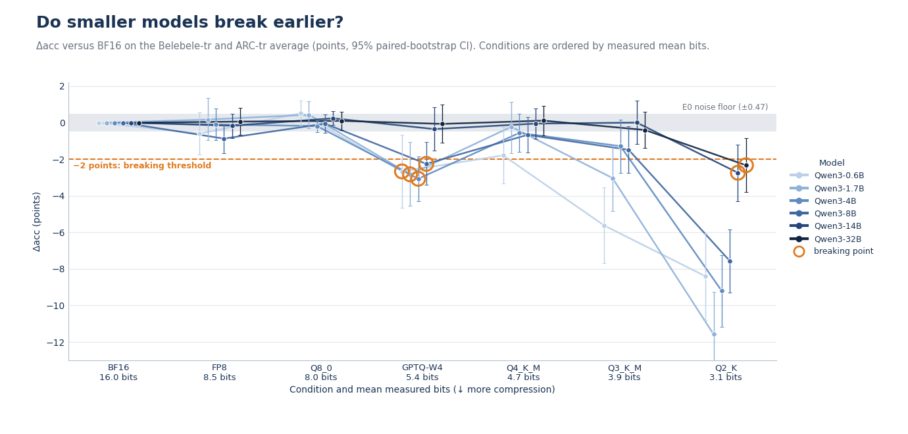
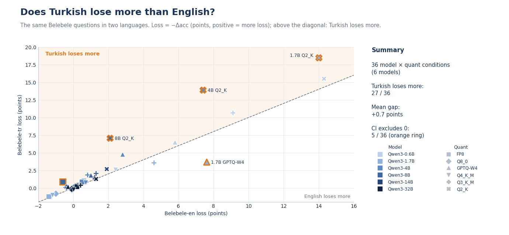
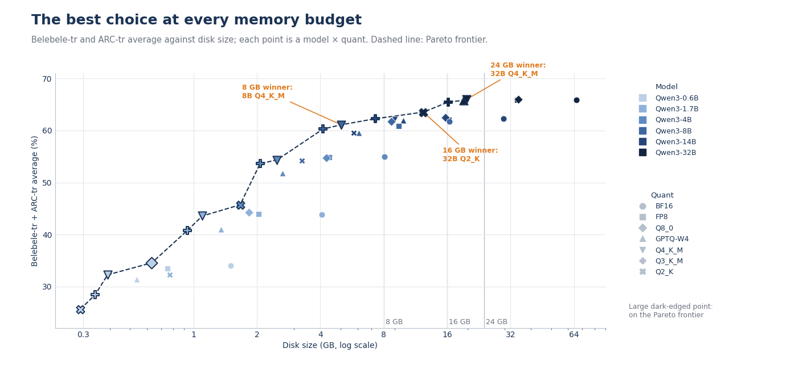
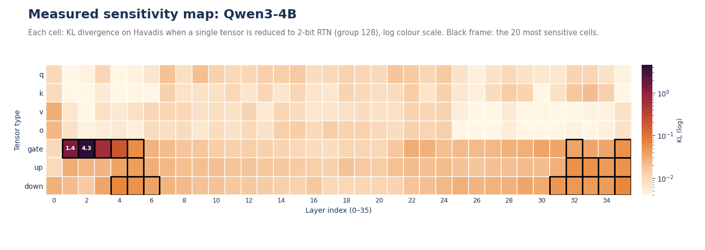

# LLM Quantization Experiments — Qwen3, Turkish & English

What happens to a language model when its weights are squeezed from 16 bits down to about 3 — and does
Turkish suffer more than English?

This repository holds the code, the protocol and the figures behind a set of quantization experiments on
the **Qwen3** family (0.6B, 1.7B, 4B, 8B, 14B, 32B). Each model is compared against its BF16 original
after **FP8**, **GPTQ (W4)** and **GGUF** (Q8_0, Q4_K_M, Q3_K_M, Q2_K) quantization, on Turkish and English
benchmarks, with KL divergence, memory and speed measurements.

📖 **The blog post explains the experiments and the results:**
[Türkçe](https://kureansiklopedi.com/tr/detay/<WILL-BE-POPULATED-SOON>) ·
[English](https://kureansiklopedi.com/en/detay/<WILL-BE-POPULATED-SOON>)

🇹🇷 Türkçe okuyun: [README_TR.md](README_TR.md)

This repo is not a tutorial on quantization — it is the experiment itself. A short primer is included
below because the figures are easier to read with it.

## Highlights

| | |
|---|---|
|  |  |
| **E1.1** — Δacc against BF16 for every model and quantization. The grey band is the measurement noise floor (±0.47 points); the dashed line is the −2-point breaking threshold; orange rings mark each model's breaking point. | **E1.3** — The same Belebele questions in both languages. In the 36 plotted model × quant conditions Turkish loses more in 27; the mean gap is +0.7 points, and 5 of 36 confidence intervals exclude 0. |
|  |  |
| **E3.1** — Accuracy against disk size for all 42 model × quant points; the dashed line is the Pareto frontier and the best option at 8, 16 and 24 GB is labelled. | **E5.1** — Which tensors of Qwen3-4B hurt most when reduced to 2 bits (KL, log colour scale); the 20 most sensitive cells are framed. |

All 12 figures are in [`figures/en`](figures/en) (English) and [`figures/tr`](figures/tr) (Turkish), each as
PNG + SVG with the data it plots as CSV. File names keep the original Turkish words (`GORSEL` = visual,
`MINI_DENEME` = mini experiment, `ORNEK` = example).

| ID | Figure |
|---|---|
| `GORSEL_E.1` | How the experiments connect |
| `GORSEL_E1.1` | Do smaller models break earlier? |
| `GORSEL_E1.2` | Quant × model × benchmark (Δacc and flip rate) |
| `GORSEL_E1.3` | Does Turkish lose more than English? |
| `GORSEL_E2.1` | Does the calibration language reduce Turkish loss? |
| `GORSEL_E3.1` | The best choice at every memory budget |
| `GORSEL_E4.1` | Speed: the bandwidth wall and concurrency |
| `GORSEL_E5.1` | Measured sensitivity map: Qwen3-4B |
| `GORSEL_E5.2` | Recipes at the same size |
| `GORSEL_E6.1` | Context and memory: KV cache quantization |
| `MINI_DENEME_3.1` | Same sentence, two languages, how many tokens? |
| `ORNEK_0.1` | Same prompt, two answers (the English version adds a labelled translation) |

## The experiments

| ID | Question | Design |
|---|---|---|
| **E0** | Can the measurements be trusted? | Qwen3-8B: BF16 re-run noise floor, consistency of the two evaluation paths (llama.cpp vs dequantized weights), ordering Q8_0 → Q2_K. |
| **E1** | Where does each model break? | 6 models × BF16 + 6 quantizations (FP8, GPTQ-W4, GGUF Q8_0 / Q4_K_M / Q3_K_M / Q2_K), Turkish-calibrated. Belebele (tr/en), ARC (tr), GPQA (tr), plus KL on Turkish news text. |
| **E2** | Does the calibration language matter? | GPTQ-W4 and Q3_K_M calibrated on English, Turkish or mixed text (Qwen3-1.7B and 4B), against uncalibrated controls (RTN-W4, Q3_K_M without imatrix). |
| **E3** | What is the best model for a memory budget? | Post-processing of E1 only: Pareto frontier and the top choices at 8 / 16 / 24 GB (including KV cache at 4K context). |
| **E4** | How fast is it? | Qwen3-8B and 32B on an H100 with llama.cpp and vLLM, against the memory-bandwidth bound (3.35 TB/s ÷ bytes read per token). |
| **E5** | Which tensors matter? | Per-tensor 2-bit sensitivity map of Qwen3-4B (36 layers × 7 tensor types), then recipes of equal size against uniform Q3_K_M, random recipes and Unsloth Dynamic. |
| **E6** | What do KV cache and `lm_head` quantization cost? | KV cache F16 / Q8_0 / Q4_0 × context 4K / 16K / 32K on Qwen3-8B (peak VRAM, decode speed, needle-in-a-haystack recall, 5 trials per cell); `lm_head` at Q8_0 / Q4_K. |
| demos | Tokens and readability | Token boundaries of the same paragraph in Turkish and English; a blind comparison of BF16 and GGUF answers from Qwen3-32B. |

The published figures also include results from later reruns that extend the baseline plan (for example
the 32B Q8_0 / Q3_K_M evaluations and the 8B recipe transfer in E5). `configs/experiments.yaml` still
describes the original reduced plan.

## A short primer

- **Quantization** stores the weights in fewer bits (**bpw** = bits per weight) so the model needs less
  memory and moves fewer bytes per generated token.
- **FP8** (dynamic W8A8), **GPTQ** (W4A16: 4-bit weights, calibrated on sample text to compensate the
  rounding error) and **GGUF k-quants** (llama.cpp's block-wise formats with mixed bit widths; the quality
  of the low-bit ones depends on an *importance matrix*, "imatrix", computed from calibration text).
- **Δacc** is the accuracy change against the BF16 original, with a paired-bootstrap 95% CI. A **flip** is a
  question whose correctness changes (right → wrong or wrong → right), which can be large even when Δacc
  is small. **KL divergence** compares the next-token distributions of the quantized and the BF16 model on
  Turkish news text.
- **Noise floor**: re-running BF16 itself does not give identical numbers; E0 measures that spread so that
  smaller differences are not over-interpreted.
- **Breaking point**: the first condition (in order of measured bits) with Δ ≤ −2 points whose CI
  excludes 0.
- **Protocol**: 0-shot, log-likelihood multiple-choice scoring, chat template off, the same questions for
  every condition.

## Repository layout

```
configs/    experiment grids (models, quants, tasks, experiments)
data/       own texts (demo paragraphs, needles) and the hash manifest of the calibration sets
docs/       RUNBOOK.md — how to run the full queue on a GPU machine
env/        requirements and the pinned llama.cpp commit
figures/    en/ and tr/ — the published figures (PNG, SVG, CSV)
scripts/    experiment pipeline: t0 (data/models), q (quantize), eval, kl, e4/e5/e6, stats, scheduler
tasks/      lm-eval task definitions (ARC-tr, GPQA-tr)
tests/      unit tests for the pipeline (CPU only)
```

## Running it

**Tests (CPU, no GPU needed)**

```bash
python -m venv .venv && source .venv/bin/activate      # Windows: .venv\Scripts\activate
pip install -r env/requirements.local.txt
python -m pytest
```

**The full experiment queue** needs NVIDIA H100 80 GB GPUs (the published runs used H100 80GB HBM3,
CUDA 13.0), Ubuntu 22.04, vLLM, llm-compressor and a CUDA build of llama.cpp. The reduced plan is about
6.5–7 GPU-hours. Step-by-step instructions: [docs/RUNBOOK.md](docs/RUNBOOK.md).

- Copy `.env.example` to `.env` or export `HF_TOKEN`; it is only needed for gated datasets and is only ever
  read from the environment.
- `env/llamacpp_commit.txt` pins the llama.cpp commit used for every published run. The Python package
  versions are listed in `env/requirements.base.txt` without exact pins.
- GPU results are not bit-exact between runs; that residual is what E0 measures.

**Data.** No third-party text is stored here. The calibration sets and the Turkish evaluation text are
rebuilt from Hugging Face by `scripts/t0/` with fixed seeds, and `data/manifest_calib.json` holds their
SHA-256 hashes so you can verify them. The Turkish GPQA translation is gated: its question text is never
printed or stored (only an answer-order permutation, `tasks/gpqa_tr_perm.json`), and a leak scan guards
that (`tests/test_leak_scan.py`).

## Licences and credits

Code, figures and documentation: [MIT](LICENSE). Models and datasets keep their own licences — see the
Hugging Face cards of Qwen3, Belebele (`facebook/belebele`), ARC-tr (`malhajar/arc-tr-v0.2`), GPQA-tr
(`ytu-ce-cosmos/gpqa-extended_tr`), C4 (`allenai/c4`), BellaTurca and Havadis (`turkish-nlp-suite`).
