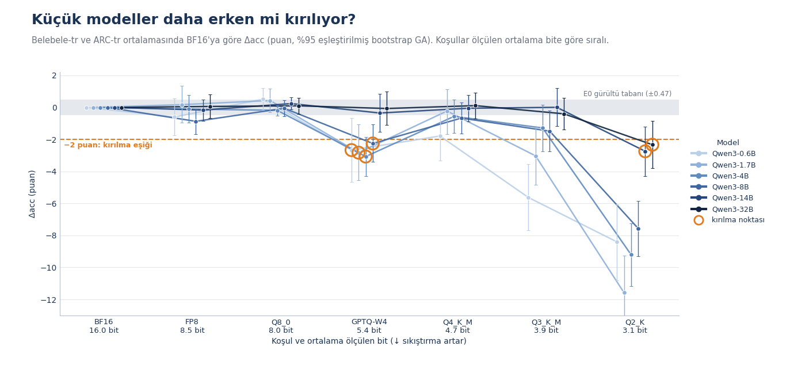
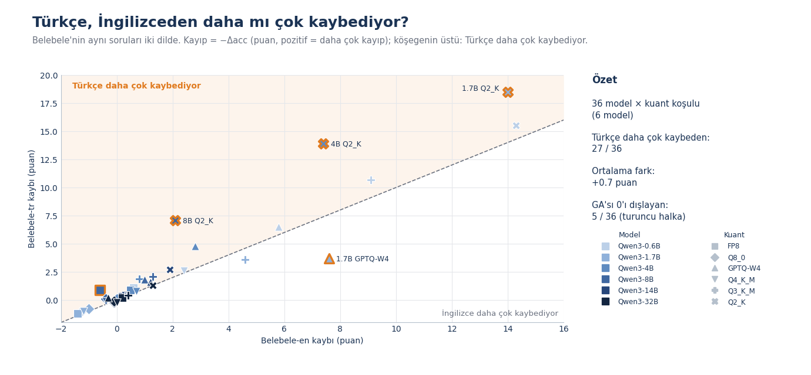
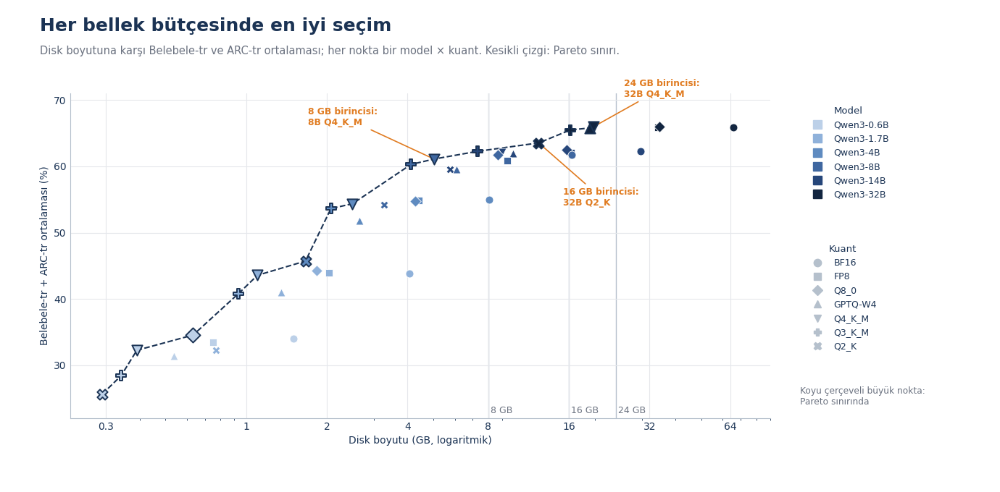
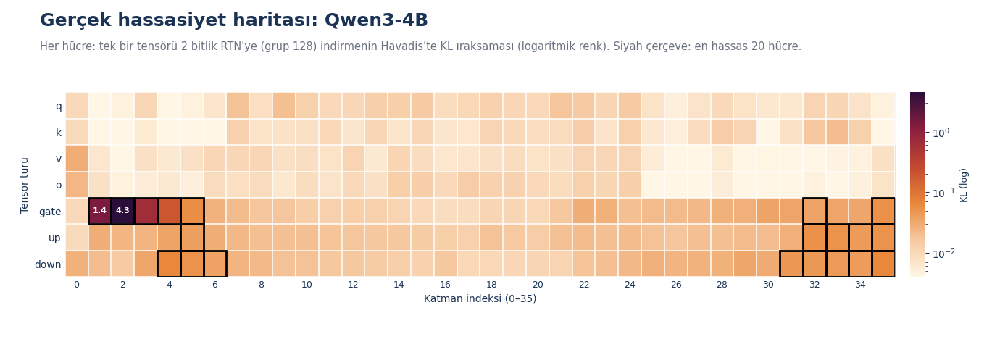

# LLM Kuantizasyon Deneyleri — Qwen3, Türkçe ve İngilizce

Bir dil modelinin ağırlıkları 16 bitten yaklaşık 3 bite sıkıştırılınca ne olur — ve Türkçe, İngilizceden
daha mı çok zarar görür?

Bu depo, **Qwen3** ailesi (0.6B, 1.7B, 4B, 8B, 14B, 32B) üzerindeki kuantizasyon deneylerinin kodunu,
protokolünü ve görsellerini içerir. Her model, **FP8**, **GPTQ (W4)** ve **GGUF** (Q8_0, Q4_K_M, Q3_K_M,
Q2_K) kuantizasyonlarından sonra BF16 aslıyla; Türkçe ve İngilizce kıyaslamalar, KL ıraksaması, bellek ve
hız ölçümleriyle karşılaştırılır.

📖 **Deneyleri ve sonuçları anlatan blog yazısı:**
[Türkçe](https://kureansiklopedi.com/tr/detay/<WILL-BE-POPULATED-SOON>) ·
[English](https://kureansiklopedi.com/en/detay/<WILL-BE-POPULATED-SOON>)

🇬🇧 English: [README.md](README.md)

Bu depo bir kuantizasyon dersi değil, deneyin kendisidir. Görselleri okumayı kolaylaştırmak için aşağıda
kısa bir ön bilgi bölümü var.

## Öne çıkanlar

| | |
|---|---|
|  |  |
| **E1.1** — Her model ve kuantizasyon için BF16'ya göre Δacc. Gri bant ölçüm gürültü tabanı (±0.47 puan), kesikli çizgi −2 puanlık kırılma eşiği, turuncu halkalar her modelin kırılma noktası. | **E1.3** — Belebele'nin aynı soruları iki dilde. Çizilen 36 model × kuant koşulunun 27'sinde Türkçe daha çok kaybediyor; ortalama fark +0.7 puan, 36 güven aralığının 5'i 0'ı dışlıyor. |
|  |  |
| **E3.1** — 42 model × kuant noktası için doğruluk–disk boyutu; kesikli çizgi Pareto sınırı, 8, 16 ve 24 GB için en iyi seçenek etiketli. | **E5.1** — Qwen3-4B'de hangi tensörleri 2 bite indirmek en çok zarar veriyor (KL, logaritmik renk); en hassas 20 hücre çerçeveli. |

12 görselin tamamı [`figures/tr`](figures/tr) (Türkçe) ve [`figures/en`](figures/en) (İngilizce)
klasörlerinde; her biri PNG + SVG olarak, çizdiği veri de CSV olarak yanında. Dosya adları özgün Türkçe
sözcükleri korur (`GORSEL` = görsel, `MINI_DENEME` = mini deneme, `ORNEK` = örnek).

| Kimlik | Görsel |
|---|---|
| `GORSEL_E.1` | Deneylerin bağlantısı |
| `GORSEL_E1.1` | Küçük modeller daha erken mi kırılıyor? |
| `GORSEL_E1.2` | Kuant × model × benchmark (Δacc ve flip oranı) |
| `GORSEL_E1.3` | Türkçe, İngilizceden daha mı çok kaybediyor? |
| `GORSEL_E2.1` | Kalibrasyon dili Türkçe kaybını azaltıyor mu? |
| `GORSEL_E3.1` | Her bellek bütçesinde en iyi seçim |
| `GORSEL_E4.1` | Hız: bant genişliği duvarı ve eşzamanlılık |
| `GORSEL_E5.1` | Gerçek hassasiyet haritası: Qwen3-4B |
| `GORSEL_E5.2` | Aynı boyutta reçeteler |
| `GORSEL_E6.1` | Bağlam ve bellek: KV cache kuantizasyonu |
| `MINI_DENEME_3.1` | Aynı cümle, iki dil, kaç token? |
| `ORNEK_0.1` | Aynı prompt, iki cevap |

## Deneyler

| Kimlik | Soru | Tasarım |
|---|---|---|
| **E0** | Ölçümlere güvenilebilir mi? | Qwen3-8B: BF16 tekrarının gürültü tabanı, iki değerlendirme yolunun (llama.cpp ve geri açılmış ağırlıklar) tutarlılığı, Q8_0 → Q2_K sıralaması. |
| **E1** | Her model nerede kırılıyor? | 6 model × BF16 + 6 kuantizasyon (FP8, GPTQ-W4, GGUF Q8_0 / Q4_K_M / Q3_K_M / Q2_K), Türkçe kalibrasyonlu. Belebele (tr/en), ARC (tr), GPQA (tr) ve Türkçe haber metninde KL. |
| **E2** | Kalibrasyon dili önemli mi? | GPTQ-W4 ve Q3_K_M'nin İngilizce, Türkçe veya karışık metinle kalibrasyonu (Qwen3-1.7B ve 4B); kalibrasyonsuz kontrollerle (RTN-W4, imatrix'siz Q3_K_M) karşılaştırma. |
| **E3** | Bir bellek bütçesi için en iyi model hangisi? | Yalnızca E1'in son işlenmesi: Pareto sınırı ve 8 / 16 / 24 GB için ilk seçimler (4K bağlamda KV cache dahil). |
| **E4** | Ne kadar hızlı? | Qwen3-8B ve 32B, H100, llama.cpp ve vLLM; bellek bant genişliği sınırına (3.35 TB/s ÷ token başına okunan bayt) karşı. |
| **E5** | Hangi tensörler önemli? | Qwen3-4B için tensör bazında 2 bit hassasiyet haritası (36 katman × 7 tensör türü); ardından aynı boyutta reçeteler: tekdüze Q3_K_M, rastgele reçeteler ve Unsloth Dynamic ile karşılaştırma. |
| **E6** | KV cache ve `lm_head` kuantizasyonunun bedeli ne? | Qwen3-8B'de KV cache F16 / Q8_0 / Q4_0 × bağlam 4K / 16K / 32K (tepe VRAM, decode hızı, needle-in-a-haystack geri çağırma, hücre başına 5 deneme); `lm_head` Q8_0 / Q4_K. |
| demolar | Token'lar ve okunabilirlik | Aynı paragrafın Türkçe ve İngilizce token sınırları; Qwen3-32B'nin BF16 ve GGUF cevaplarının kör karşılaştırması. |

Yayımlanan görseller, temel planı genişleten sonraki tekrar koşumlarının sonuçlarını da içerir (örneğin
32B Q8_0 / Q3_K_M değerlendirmeleri ve E5'te 8B'ye reçete aktarımı). `configs/experiments.yaml` hâlâ
özgün, kısıtlı planı tanımlar.

## Kısa ön bilgi

- **Kuantizasyon**, ağırlıkları daha az bitle saklar (**bpw** = ağırlık başına bit); böylece model daha az
  bellek kaplar ve üretilen her token için daha az bayt okur.
- **FP8** (dinamik W8A8), **GPTQ** (W4A16: 4 bitlik ağırlıklar; yuvarlama hatasını telafi etmek için örnek
  metinle kalibre edilir) ve **GGUF k-quant'lar** (llama.cpp'nin karma bit genişlikli, blok tabanlı
  biçimleri; düşük bitlilerin kalitesi kalibrasyon metninden çıkarılan bir *önem matrisine*, "imatrix"e
  bağlıdır).
- **Δacc**, BF16 aslına göre doğruluk değişimidir; eşleştirilmiş bootstrap %95 güven aralığıyla verilir.
  **Flip**, doğruluğu değişen sorudur (doğrudan yanlışa ya da yanlıştan doğruya); Δacc küçükken bile büyük
  olabilir. **KL ıraksaması**, kuantize ve BF16 modelin sonraki-token dağılımlarını Türkçe haber metninde
  karşılaştırır.
- **Gürültü tabanı**: BF16'yı yeniden çalıştırmak bile birebir aynı sayıları vermez; E0 bu yayılımı ölçer,
  böylece ondan küçük farklar fazla yorumlanmaz.
- **Kırılma noktası**: ölçülen bit sırasına göre, Δ ≤ −2 puan olan ve güven aralığı 0'ı dışlayan ilk koşul.
- **Protokol**: 0-shot, log-olasılık tabanlı çoktan seçmeli puanlama, sohbet şablonu kapalı, her koşulda
  aynı sorular.

## Depo yapısı

```
configs/    deney ızgaraları (modeller, kuantlar, görevler, deneyler)
data/       kendi metinlerimiz (demo paragrafları, needle'lar) ve kalibrasyon kümelerinin özet (hash) listesi
docs/       RUNBOOK.md — tam kuyruğu bir GPU makinesinde çalıştırma rehberi (İngilizce)
env/        gereksinimler ve sabitlenmiş llama.cpp commit'i
figures/    en/ ve tr/ — yayımlanan görseller (PNG, SVG, CSV)
scripts/    deney hattı: t0 (veri/model), q (kuantizasyon), eval, kl, e4/e5/e6, stats, scheduler
tasks/      lm-eval görev tanımları (ARC-tr, GPQA-tr)
tests/      hat için birim testleri (yalnızca CPU)
```

## Çalıştırma

**Testler (CPU, GPU gerekmez)**

```bash
python -m venv .venv && source .venv/bin/activate      # Windows: .venv\Scripts\activate
pip install -r env/requirements.local.txt
python -m pytest
```

**Tam deney kuyruğu** için NVIDIA H100 80 GB GPU'lar (yayımlanan koşumlar H100 80GB HBM3, CUDA 13.0 ile
yapıldı), Ubuntu 22.04, vLLM, llm-compressor ve CUDA ile derlenmiş llama.cpp gerekir. Kısıtlı plan yaklaşık
6.5–7 GPU-saattir. Adım adım anlatım: [docs/RUNBOOK.md](docs/RUNBOOK.md) (İngilizce).

- `.env.example` dosyasını `.env` olarak kopyalayın ya da `HF_TOKEN` değişkenini tanımlayın; yalnızca gated
  veri kümeleri için gerekir ve her zaman yalnızca ortam değişkeninden okunur.
- `env/llamacpp_commit.txt`, yayımlanan tüm koşumlarda kullanılan llama.cpp commit'ini sabitler. Python
  paket sürümleri `env/requirements.base.txt` içinde, kesin sürüm sabitlemesi olmadan listelenir.
- GPU sonuçları koşumlar arasında birebir aynı değildir; E0'ın ölçtüğü artık budur.

**Veri.** Depoda üçüncü taraf metin tutulmaz. Kalibrasyon kümeleri ve Türkçe değerlendirme metni,
`scripts/t0/` ile sabit tohumlarla Hugging Face'ten yeniden üretilir; `data/manifest_calib.json` bunların
SHA-256 özetlerini içerir, böylece doğrulayabilirsiniz. Türkçe GPQA çevirisi gated'dir: soru metni asla
yazdırılmaz ya da saklanmaz (yalnızca cevap sırası permütasyonu, `tasks/gpqa_tr_perm.json`) ve bir sızıntı
taraması bunu korur (`tests/test_leak_scan.py`).

## Lisanslar ve kaynaklar

Kod, görseller ve belgeler: [MIT](LICENSE). Modeller ve veri kümeleri kendi lisanslarını korur — Qwen3,
Belebele (`facebook/belebele`), ARC-tr (`malhajar/arc-tr-v0.2`), GPQA-tr (`ytu-ce-cosmos/gpqa-extended_tr`),
C4 (`allenai/c4`), BellaTurca ve Havadis (`turkish-nlp-suite`) için Hugging Face kartlarına bakın.
